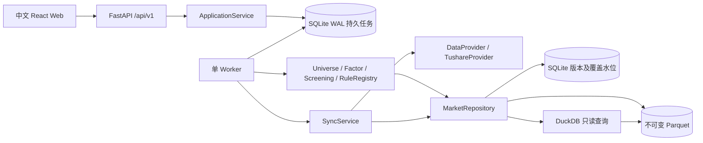

# 架构

V0.1 为个人使用的模块化单体。后端 API、单 Worker 和前端分别运行，共享一个仓库。SQLite WAL 保存业务记录和持久任务队列，Parquet 保存市场数据和筛选结果，DuckDB 只读分析不可变文件。单 Worker 内部使用有界线程池并发读取HTTP接口，全线程共享请求限速；数据版本发布和检查点仍由单线程顺序写入，避免清单更新竞争。

依赖方向：API → 应用服务 → 股票池/因子/筛选领域 → MarketRepository；同步服务 → DataProvider → Tushare HTTP 适配器。领域模块不依赖 FastAPI、Tushare 或前端。

核心接口：DataProvider.fetch(dataset, params) / capabilities；MarketRepository.read(dataset, version, codes, end_date)；FactorEngine.compute(date, codes, version)；UniverseManager.resolve(date, universe, version)；RuleRegistry.validate / describe；ScreeningEngine.run(request, version)。通用 Strategy、BacktestEngine 扩展协议仍不执行自定义代码；内置单股回测见V0.3。PortfolioService、NotificationService只保留协议。

任务在 SQLite 中持久化，提交返回 202。Worker 文件锁确保只有一个任务执行进程，心跳显示活跃状态，重启时恢复遗留运行任务，取消在安全分片边界生效。筛选固定提交时的数据清单及规则/因子版本，重启可以重算；同步从已发布检查点继续。计算版本发生变化时旧任务明确失败，避免同一任务悄然换用新算法。

Compose 网页宿主端口按用户部署要求绑定 `0.0.0.0`，API仍只通过内部nginx代理访问；宿主直接运行API默认本机绑定。公网部署应配置 API_ACCESS_TOKEN 并限制源站端口访问；前端允许用户输入访问密钥，仅保存在页面内存。公网访问通过HTTPS反向代理或Cloudflare Tunnel，并配置访问控制。

决策理由：不引入 Redis/Celery；DuckDB 不作为共享可写数据库；不可变文件和事务清单使 API 与 Worker 安全共享数据；因子与规则分离便于回测复用。默认仅沪深 A 股，北交所身份及代码迁移留至后续。
# 当前部署数据卷

`compose.override.yaml` 将 API 与 Worker 的 `/app/data` 同时指向 `ashare-lab-real-data`。原 `ashare-lab_lab-data` 测试卷保留，真实与测试行情不混用。重建服务继续使用真实卷；同步任务与版本检查点随卷持久化。

# 分红日更、月度名称与存续证券策略

单Worker取得文件锁后在启动时和每分钟检查增量每日16:00、分红每日01:00、名称每月首个周六05:00任务，均为北京时间。到期日期／月份占用记录与任务插入在同一SQLite事务中完成；不增加调度进程。错过多次仅补交最近到期的一次，失败／部分完成由用户恢复原任务。增量仅在已有真实日线文件清单时启用，检查初始化状态不扫描全量历史文件；任务显式固定到期日期，不依赖22:00默认截止规则。名称保留原月份占用键，调整时间不重复提交同月任务。调度线程仅负责入队，长任务执行期间仍可按时提交；任务实际执行等待单Worker队列。schedule状态由应用服务读取，同步API仅验证和提交。

新同步snapshot带`_sync_policy=daily_dividends_v2`，增量跳过分红、初始化保留分红；`monthly_names_v1`仍识别为存续证券策略并保留原增量分红流程，缺少标记的旧同步继续历史股票池流程。独立分红／名称任务固定目标股票列表和观察日期，恢复不扩大目标，已发布检查点不重复请求；分红任务不要求已有行情。新筛选带`_universe_policy=survivors_v1`，按固定基础信息版本中的退市状态排除历史退市证券；旧筛选缺少标记时Worker沿用历史股票池。数据文件和已有任务结果保持不变。基础退市状态不是历史行情：策略有意筛选存续股票，并在页面及导出中标注幸存者偏差。

# V0.2 月度定投

新增 API → DcaService → DCA领域引擎 → MarketRepository。DcaService验证显式版本、股票及交易日历，复用jobs入队；Worker显式分派sync/screening/dca，DCA不依赖FastAPI或供应商接口。初始配置复用当前数据版本，提交后固定整个映射；运行中不回退到当前头版本。

DCA结果采用不可变JSON并通过临时文件、fsync和原子替换发布，SQLite任务只保存摘要和文件引用；结果接口分页账本，CSV读取完整账本。重启从原快照全量重算，旧结果仍可读，引擎版本不兼容明确失败。无业务表迁移，不改变数据同步或已有筛选语义；取消检查在逐日及发布前进行。

## 股票联想与展示

StockInput统一定投、自选股票池和结果搜索，支持键盘选择、输入法、多选/删除及批量粘贴。查询从本地固定stock_basic版本读取，ApplicationService实例缓存最多8组版本/日期股票池；新版本另建缓存，不改变旧任务。供应商cnspell及本地pypinyin首字母/全拼共同匹配，输入时不请求Tushare。UI正收益红、负收益绿、中性黑；金额绝对值超过1000元显示四舍五入整数，百分数两位；计算和CSV精度保持原口径。

## 历史增量与独立管理认证（2026-10-09）

新增HistoryRefresh服务，SyncService在history_incremental_v3策略下委派分红与名称同步；API仅做输入验证和服务调用。v2及更早任务继续原全历史策略。Worker仍通过文件锁串行发布，所有调度与手动请求共用同一Provider限速器。每日增量与月度全量分别持久登记槽位；沿用名称月度槽位以避免升级重复入队。

任务snapshot保存固定基线版本、截止日、股票池、范围、查询结果、发现完成标记和目标列表。每次日期发现成功后保存snapshot；逐股完整历史发布和checkpoint同事务；最后观察覆盖与任务succeeded/result同事务提交。检查点完成后的中断复用原目标和查询，未完成的查询重新获取。历史发布只改写目标股票所在不可变分片；修订、更改日期或撤销事件不再残留旧行，旧manifest继续读取。已有历史返回空结果不删除。

stock覆盖保留完整历史基线日期，history:observation记录连续扫描截至日及完整股票清单，full_as_of_date记录最近全量覆盖。筛选与定投共用history_complete_codes，必须存在逐股完整基线才能使用观察日期。扫描回查30天，分红追加365天内未实施或派息缺失/未到期股票；名称追加基础名称差异股票。名称范围达到上限递归拆分日期，单日溢出用所有目标股票的完整请求校正；单股仍达上限时停止提交覆盖。窗口外的历史修订由月度全量补偿，不构造接口未提供的名称结束日期。

HTTP中间件在原API_ACCESS_TOKEN验证后执行管理认证，恒定时间比较UTF-8字节，所有/data/*及可能包含sync的/jobs列表保持锁定。SecretStr配置与通用错误避免输出凭据。前端密码只在/data页面组件内存，解锁验证成功才挂载管理内容；离开或刷新重新锁定，403专用事件卸载内容并停止轮询。研究摘要不返回同步任务列表，本地CLI和Worker不经过页面认证。

## V0.3 单股回测

API→BacktestService→内置逐日回测引擎→MarketRepository。研究版本、交易日历/股票验证与不可变JSON/分页/CSV复用DcaService；公开现金事件校验复用定投领域函数，复权价格构造复用因子模块。领域引擎只执行买入持有和均线交叉，不依赖FastAPI或供应商接口。

jobs新增kind=backtest，snapshot固定_backtest_version/_strategy_version/_universe_policy及全部数据版本，Worker与dca共用原子JSON发布分支。取消在逐日和发布前检查；重启从原快照重算，不重复现金/权益/税款，不改变旧dca/screening/sync算法版本。没有业务迁移，不改变数据同步和调度。回测任务列表列为研究接口，管理任务列表继续独立认证。

前端/backtest懒加载，菜单及标题为“单股回测”；股票输入、金额颜色、分页恢复和曲线复用现有组件。研究结果只保存在任务文件中，不新增持仓/现金数据库表。

## 有界查询与统计摘要

不可变文件路径与数据版本分别对应partition_statistics和dataset_summaries派生表，均带统计格式版本。统计保留原行数、日期范围和精确股票去重数；不把股票代码最小/最大值当成股票数。新文件统计与清单、检查点同事务写入；已有文件通过`ashare statistics`逐文件补齐，每256文件持久提交一次，重复或中断后重跑不会改写行情。版本摘要完成后才发布，失败不缓存。进程内锁合并同时到达的冷摘要请求，多个进程的派生写入使用唯一键幂等处理。状态请求固定一次数据快照，任务状态另行实时查询。

仓库按月份和股票哈希桶裁剪清单，查询始终再应用精确代码/日期过滤。无法识别的旧分区保留并有界回退；每次DuckDB绑定最多64文件，2线程、256MB缓冲预算，进程内仅一个仓库查询同时执行。这个预算不代表进程总内存上限，仍须在1GiB容器内测量实际工作集。最后交易日逐月反向查找，对尚无记录股票继续历史回溯。筛选每批最多256股票，共享交易日窗口和历史覆盖，批间检查取消/更新进度，结果原子发布前最高95%。不改变规则、因子版本或旧股票池语义。

研究任务连续第三次运行中断后停止自动恢复并标记failed；新增计数保存在固定snapshot的内部键，旧attempt不被当作中断证据。取消优先，同步任务仍依赖原检查点恢复。前端轮询等待响应结束后再延迟原间隔，刷新请求合并，离开页面取消，认证失效停止。

状态服务对覆盖明细保留最多32个版本的元数据缓存、4个完整市场快照缓存；按完整版本组合失效，副本保护避免调用者修改缓存。HTTP状态接口另缓存不可变部分的JSON编码，动态任务、配置与调度每次独立生成后组合，避免每15秒重新解码/序列化大量覆盖记录。公开与管理接口仍分别过滤同步任务，认证发生在读取之前，OpenAPI与JSON字段不变。
