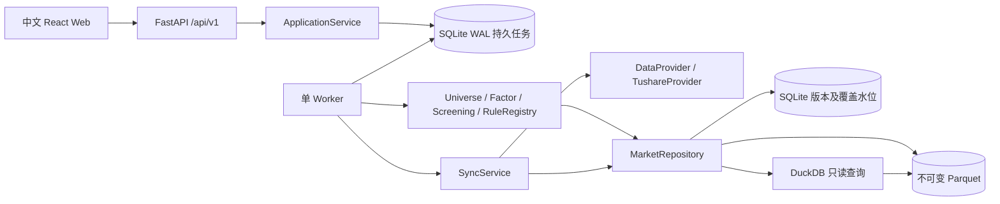

# 架构

V0.1 为个人使用的模块化单体。后端 API、单 Worker 和前端分别运行，共享一个仓库。SQLite WAL 保存业务记录和持久任务队列，Parquet 保存市场数据和筛选结果，DuckDB 只读分析不可变文件。单 Worker 进程内有一个同步执行名额和最多两个研究执行名额，独立有界线程池调度；同步内部仍并发读取 HTTP 接口，全线程共享请求限速。数据版本发布和检查点由唯一同步任务顺序写入，避免清单更新竞争。

依赖方向：API → 应用服务 → 股票池/因子/筛选领域 → MarketRepository；同步服务 → DataProvider → Tushare HTTP 适配器。领域模块不依赖 FastAPI、Tushare 或前端。

核心接口：DataProvider.fetch(dataset, params) / capabilities；MarketRepository.read(dataset, version, codes, end_date)；FactorEngine.compute(date, codes, version)；UniverseManager.resolve(date, universe, version)；RuleRegistry.validate / describe；ScreeningEngine.run(request, version)。通用 Strategy、BacktestEngine 扩展协议仍不执行自定义代码；内置单股回测见V0.3。通用持仓PortfolioService和NotificationService保留协议；内置组合回测见V0.4。

任务在 SQLite 中持久化，提交返回 202。Worker 文件锁确保只有一个任务执行进程，进程内任务可以并发，心跳显示活跃状态，重启时恢复遗留运行任务，取消在安全分片边界生效。筛选固定提交时的数据清单及规则/因子版本，重启可以重算；同步从已发布检查点继续。计算版本发生变化时旧任务明确失败，避免同一任务悄然换用新算法。

Compose 网页宿主端口按用户部署要求绑定 `0.0.0.0`，API仍只通过内部nginx代理访问；宿主直接运行API默认本机绑定。公网部署应配置 API_ACCESS_TOKEN 并限制源站端口访问；前端允许用户输入访问密钥，仅保存在页面内存。公网访问通过HTTPS反向代理或Cloudflare Tunnel，并配置访问控制。

决策理由：不引入 Redis/Celery；DuckDB 不作为共享可写数据库；不可变文件和事务清单使 API 与 Worker 安全共享数据；因子与规则分离便于回测复用。默认仅沪深 A 股，北交所身份及代码迁移留至后续。
# 当前部署数据卷

`compose.override.yaml` 将 API 与 Worker 的 `/app/data` 同时指向 `ashare-lab-real-data`。原 `ashare-lab_lab-data` 测试卷保留，真实与测试行情不混用。重建服务继续使用真实卷；同步任务与版本检查点随卷持久化。2026-10-10并发部署后，生产Worker实际启用一个同步名额及两个研究名额，内存上限2GiB；API仍1GiB，Web128MiB。

# 分红日更、月度名称与存续证券策略

单Worker取得文件锁后在启动时和每分钟检查增量每日16:00、分红每日01:00、名称每月首个周六05:00任务，均为北京时间。到期日期／月份占用记录与任务插入在同一SQLite事务中完成；不增加调度进程。错过多次仅补交最近到期的一次，失败／部分完成由用户恢复原任务。增量仅在已有真实日线文件清单时启用，检查初始化状态不扫描全量历史文件；任务显式固定到期日期，不依赖22:00默认截止规则。名称保留原月份占用键，调整时间不重复提交同月任务。调度线程仅负责入队，长任务执行期间仍可按时提交；任务实际执行等待同步通道，研究通道独立运行。schedule状态由应用服务读取，同步API仅验证和提交。

新同步snapshot带`_sync_policy=daily_dividends_v2`，增量跳过分红、初始化保留分红；`monthly_names_v1`仍识别为存续证券策略并保留原增量分红流程，缺少标记的旧同步继续历史股票池流程。独立分红／名称任务固定目标股票列表和观察日期，恢复不扩大目标，已发布检查点不重复请求；分红任务不要求已有行情。新筛选带`_universe_policy=survivors_v1`，按固定基础信息版本中的退市状态排除历史退市证券；旧筛选缺少标记时Worker沿用历史股票池。数据文件和已有任务结果保持不变。基础退市状态不是历史行情：策略有意筛选存续股票，并在页面及导出中标注幸存者偏差。

# V0.2 月度定投

新增 API → DcaService → DCA领域引擎 → MarketRepository。DcaService验证显式版本、股票及交易日历，复用jobs入队；Worker显式分派sync/screening/dca，DCA不依赖FastAPI或供应商接口。初始配置复用当前数据版本，提交后固定整个映射；运行中不回退到当前头版本。

DCA结果采用不可变JSON并通过临时文件、fsync和原子替换发布，SQLite任务只保存摘要和文件引用；结果接口分页账本，CSV读取完整账本。重启从原快照全量重算，旧结果仍可读，引擎版本不兼容明确失败。无业务表迁移，不改变数据同步或已有筛选语义；取消检查在逐日及发布前进行。

## 股票联想与展示

StockInput统一定投、自选股票池和结果搜索，支持键盘选择、输入法、多选/删除及批量粘贴。查询从本地固定stock_basic版本读取，ApplicationService实例缓存最多8组版本/日期股票池；新版本另建缓存，不改变旧任务。供应商cnspell及本地pypinyin首字母/全拼共同匹配，输入时不请求Tushare。UI正收益红、负收益绿、中性黑；金额绝对值超过1000元显示四舍五入整数，百分数两位；计算和CSV精度保持原口径。

## 历史增量与独立管理认证（2026-10-09）

新增HistoryRefresh服务，SyncService在history_incremental_v3策略下委派分红与名称同步；API仅做输入验证和服务调用。v2及更早任务继续原全历史策略。Worker仍通过文件锁串行发布，所有调度与手动请求共用同一Provider限速器。每日增量与月度全量分别持久登记槽位；沿用名称月度槽位以避免升级重复入队。

任务snapshot保存固定基线版本、截止日、股票池、范围、查询结果、发现完成标记和目标列表。每次日期发现成功后保存snapshot；逐股完整历史发布和checkpoint同事务；最后观察覆盖与任务succeeded/result同事务提交。检查点完成后的中断复用原目标和查询，未完成的查询重新获取。历史发布只改写目标股票所在不可变分片；修订、更改日期或撤销事件不再残留旧行，旧manifest继续读取。已有历史返回空结果不删除。

stock覆盖保留完整历史基线日期，history:observation记录连续扫描截至日及完整股票清单，full_as_of_date记录最近全量覆盖。筛选与定投共用history_complete_codes，必须存在逐股完整基线才能使用观察日期。扫描回查30天，分红追加365天内未实施或派息缺失/未到期股票；名称追加基础名称差异股票。名称范围达到上限递归拆分日期，单日溢出用所有目标股票的完整请求校正；单股仍达上限时停止提交覆盖。窗口外的历史修订由月度全量补偿，不构造接口未提供的名称结束日期。

HTTP中间件在原API_ACCESS_TOKEN验证后执行管理认证，恒定时间比较UTF-8字节，所有/data/*及可能包含sync的/jobs列表保持锁定。SecretStr配置与通用错误避免输出凭据。前端密码只在/data页面组件内存，解锁验证成功才挂载管理内容；离开或刷新重新锁定，403专用事件卸载内容并停止轮询。研究摘要不返回同步任务列表，本地CLI和Worker不经过页面认证。

## V0.3 单股回测

API→BacktestService→内置逐日回测引擎→MarketRepository。研究版本、交易日历/股票验证与不可变JSON/分页/CSV复用DcaService；公开现金事件校验复用定投领域函数，复权价格构造复用因子模块。领域引擎只执行买入持有和均线交叉，不依赖FastAPI或供应商接口。

jobs新增kind=backtest，snapshot固定_backtest_version/_strategy_version/_universe_policy及全部数据版本，Worker与dca共用原子JSON发布分支。取消在逐日和发布前检查；重启从原快照重算，不重复现金/权益/税款，不改变旧dca/screening/sync算法版本。没有业务迁移，不改变数据同步和调度。回测任务列表列为研究接口，管理任务列表继续独立认证。

前端/backtest懒加载，菜单及标题为“单股回测”；股票输入、金额颜色、分页恢复和曲线复用现有组件。研究结果只保存在任务文件中，不新增持仓/现金数据库表。

## 有界查询与统计摘要

不可变文件路径与数据版本分别对应partition_statistics和dataset_summaries派生表，均带统计格式版本。统计保留原行数、日期范围和精确股票去重数；不把股票代码最小/最大值当成股票数。新文件统计与清单、检查点同事务写入；已有文件通过`ashare statistics`逐文件补齐，每256文件持久提交一次，重复或中断后重跑不会改写行情。版本摘要完成后才发布，失败不缓存。进程内锁合并同时到达的冷摘要请求，多个进程的派生写入使用唯一键幂等处理。状态请求固定一次数据快照，任务状态另行实时查询。

仓库按月份和股票哈希桶裁剪清单，查询始终再应用精确代码/日期过滤。无法识别的旧分区保留并有界回退；每次DuckDB绑定最多64文件，2线程、256MB缓冲预算，进程内仅一个仓库查询同时执行。这个预算不代表进程总内存上限，仍须在1GiB容器内测量实际工作集。最后交易日逐月反向查找，对尚无记录股票继续历史回溯。筛选每批最多256股票，共享交易日窗口和历史覆盖，批间检查取消/更新进度，结果原子发布前最高95%。不改变规则、因子版本或旧股票池语义。

研究任务连续第三次运行中断后停止自动恢复并标记failed；新增计数保存在固定snapshot的内部键，旧attempt不被当作中断证据。取消优先，同步任务仍依赖原检查点恢复。前端轮询等待响应结束后再延迟原间隔，刷新请求合并，离开页面取消，认证失效停止。

状态服务对覆盖明细保留最多32个版本的元数据缓存、4个完整市场快照缓存；按完整版本组合失效，副本保护避免调用者修改缓存。HTTP状态接口另缓存不可变部分的JSON编码，动态任务、配置与调度每次独立生成后组合，避免每15秒重新解码/序列化大量覆盖记录。公开与管理接口仍分别过滤同步任务，认证发生在读取之前，OpenAPI与JSON字段不变。

### 历史任务删除与并发

API 删除入口仅转交 ApplicationService。服务在 SQLite BEGIN IMMEDIATE 事务内检查任务类型和结束状态，先清理任务专属 results 目录，再删除日志、同步检查点和任务行。文件路径由任务ID构造，不使用 result JSON 中的路径；拒绝任务目录符号链接。文件清理异常保留任务记录以便重试；数据库事务不保证文件系统回滚。

取消、恢复、Worker 领取及启动恢复也在读取状态前取得写事务，避免依据过期状态删除或执行任务。Worker 停止并等待心跳线程退出后，在同一事务中写入结束状态和最终日志，使用户看到可删除状态时任务已停止写入。自动调度入队及日志同事务提交，删除不清理 settings 中的时段领取记录，同一时段不会重新入队。删除不改变已发布版本和数据仓库 heads。

前端共享 TaskHistory 和 DeletableTasks 提供分页、结束状态删除确认及失败重试；删除当前查看任务时清除选择和 run 参数，停止详情轮询并保留研究输入。

批量历史清空复用任务结果目录清理，在单个BEGIN IMMEDIATE事务内读取当前模块所有任务，只清理结束状态；不自动取消活动任务。逐条和集合DELETE均只由API转交服务，保留任务领取、恢复和最终状态提交的并发保护。前端TaskHistory在清空完成后恢复首页，并按服务返回的全部ID清除当前详情，覆盖不在当前分页的任务。

回测与定投共享复权因子变化校验函数和账本事件样式；回测交易引擎升级至1.0.1，定投交易语义及引擎版本不变。回测CAGR在研究模块计算，旧汇总补算由BacktestService负责，不进入API层、不读取新版本行情。

## 多策略比较

API→BacktestService→comparison领域模块→共用单股成交/分红引擎。六个内置策略配置及适用参数在schemas中验证，comparison负责预热，signals负责共用指标和信号；API不计算规则。一次读取公共行情及最大预热范围，再逐策略截取各自固定窗口和独立issues，不共用现金/权益对象。每策略结果保存完整账本，概览读取去除账本，策略详情分页账本但成交标记使用全量数据。

比较使用原backtest任务类型，无表迁移；snapshot固定_comparison_version=1.0.0、_backtest_version=1.0.1及_strategy_version_<id>。Worker按请求是否含strategies分派；旧入口保留_strategy_version校验，比较逐策略校验版本。串行计算、统一取消、原子发布单文件；未知数据逐策略隔离，程序异常整个任务失败。现有恢复次数限制、删除及文件清理流程沿用。前端默认多选、历史识别旧/新结果类型；曲线/买卖点复用Lightweight Charts，指标柱状图为SVG，不增加运行依赖。

## 数据更新与研究并行（2026-10-10）

单进程文件锁保留，启动恢复只在取得所有权后执行一次。领取与执行分离，主循环按通道空位在 BEGIN IMMEDIATE 事务内领取，按 created_at/id 排序；线程池不提前领取等待任务。sync 通道一个执行名额，其他类型进入研究通道，未知类型明确失败。研究并发配置 WORKER_RESEARCH_CONCURRENCY 默认2、范围1–2；SYNC_CONCURRENCY仍仅控制HTTP预取。无需业务表迁移或任务/API格式变更。

每个任务独立心跳、进度、取消及结果路径；任务失败不会停掉其他通道。提交线程池失败时撤销未开始的领取，保留并处理同时到达的取消。SIGTERM/SIGINT停止领取，等待已提交任务结束后释放文件锁；60秒容器停止期限后可强制中断，重启复用同步检查点和研究原快照，三次研究中断保护不变。run_once及--once保持单任务执行。

历史分红/名称观察水位仍与成功结果同事务发布；发布前停止并等待心跳，事务同时提交最终日志，成功后Worker不再访问任务记录，避免结束任务删除后的读写竞争。其他任务保留原最终状态/日志事务。进程内DuckDB查询互斥和摘要锁保留，允许查询与HTTP、计算阶段交错，不保证纯Python计算同比例加速。Worker容器上限2GiB，API仍1GiB。

## 研究模块的功能与历史页签

筛选、定投、单股回测及数据管理复用前端 ModuleTabs，通过 `tab=history` 保存历史页签，`run` 继续标识任务。旧 `?run=…` 研究链接直接展示主功能结果；两个面板保留挂载以保持草稿、结果交互及历史页码，TaskHistory 的 active 开关在隐藏时停止请求与轮询。研究历史查看返回主功能，同步日志及取消/恢复集中在同步任务页签；数据管理认证仍仅存在该页面内存，刷新重新解锁。

研究界面不提供数据版本编辑或显示版本标识；请求、领域校验及历史任务快照仍保留版本绑定。新任务采用 options 的已发布快照，历史重跑沿用原版本。结果参数显示过滤嵌套 data_versions，不改变API结果、CSV或数据管理的版本排查信息。

### 策略信号筛选

筛选仍使用screening任务及原子Parquet发布，新增独立信号和规则叠加模式，不增加数据库迁移。signal_screening负责技术策略目录/版本和批次数据适配；signals通过只读数据接口协议复用既有单股算法。任务共享有界日历/覆盖上下文，256只批次行情只读取一次，各策略在内存中按自己的固定预热起点切片，禁止扩大窗口改变递归种子。纯规则任务保留原计算版本及股票池兼容行为。

Worker固定信号筛选版本和各策略版本，中断全量重算沿用原快照，不兼容版本失败。结果signal_results作为JSON列序列化，旧Parquet读取允许缺列，既有文件不改写。界面共用历史说明格式化与策略参数编辑组件；规则1.0.0的展示含义与任务保存参数结合，缺少参数或未知版本显示未知，嵌套F条件保持逻辑层级。

### 研究功能分页（2026-10-10）

股票筛选、定投模拟和单股回测使用参数、结果、历史任务三个分页，通过查询参数 `tab=result` / `tab=history` 与 `run` 定位。成功任务自动进入结果分页，历史查看使用相同入口；各面板保留挂载，任务状态独立于分页展示。首页重定向至股票筛选，研究概览不再提供导航或页面入口。图表与任务名称的股票展示元数据通过任务指定交易日和 `stock_basic` 版本查询，不参与研究规则计算。

## V0.4 组合回测

API → PortfolioBacktestService → 组合领域引擎 → MarketRepository。新增kind=portfolio，无业务表迁移；与筛选、定投、单股回测共用两个研究执行名额，不新增内部股票并行线程。行情按固定版本和代码批量裁剪，日历及覆盖共享、每股独立预热；信号复用既有因子及比较模块的定义，账户使用共享现金及逐股FIFO批次、分红权益和部分卖出税负。

实际组合与买入持有基准共享行情加载、独立核算。一个任务原子发布一个不可变JSON，保存完整账本、日持仓、曲线和OHLC；应用服务返回概览、按日期持仓、逐股成交详情和四类全量CSV。portfolio恢复和原子发布加入既有Worker路径；快照固定组合引擎、依赖交易及策略版本，不改变旧研究引擎。数据未知按账户停止，程序失败/取消按整个任务处理。

前端/portfolio懒加载，正式导航位于单股回测与数据管理之间。配置、结果及历史保持挂载；结果使用不可变参数，编辑下一次研究草稿不改变旧结果的名称/版本口径。账本分页独立请求，不卸载收益图表。历史、取消、删除复用既有组件；研究API仍受全站Bearer保护，portfolio列表不要求管理密码，未指定类型的/jobs仍锁定。

## 六策略知识库

`/knowledge` 为懒加载静态前端页面，无 API 请求、认证或数据版本读取。`knowledge.ts` 按现有 `StrategyId` 维护思路、计算口径、人工信号示例和外部教育资料，名称、参数与预热天数复用 `comparison.ts`；研究引擎仍是规则来源，知识库不计算信号或修改任务。页面目录通过 URL hash 使用策略 ID 定位，React Router 的 location 变化驱动标题滚动及键盘焦点，支持刷新和前进/后退。侧栏入口位于组合回测之后，单股回测“策略说明”新窗口打开，以保留原研究草稿；延伸阅读标明机构、英文、新窗口并使用 noopener/noreferrer。首版不包含筛选、定投或组合教程。

## 信号通知 V1

新增 NotificationService 与 notifications APIRouter。API仅验证输入、邮箱账号会话及调用服务，规则在 `signals.py`：从comparison抽取EMA/RSI/技术信号，comparison保留ema/rsi兼容导出；从backtest提取原双均线窗口函数，旧交易引擎/版本不变。独立通知加载器固定五个依赖版本，只读信号日及之前的指标行情，不读取分红/成交限制或运行资金模拟。

Alembic0004新增匿名主体、加密渠道、订阅、不可变检查、持久逐渠道outbox、验证码摘要、持久限流计数及SMTP服务状态。0005保留原owner_id及所有关联业务表，增加邮箱账号映射、独立多设备会话及分用途验证码表，旧匿名会话和恢复码字段仅留失效占位值。NotificationAuth负责验证码原子消费、唯一邮箱账号与旧身份接续、会话及邮箱更换；普通登录不会写渠道或订阅修订。随机会话只存摘要，六位验证码存HMAC摘要（防数据库泄露后离线穷举）；Webhook完整URL和邮箱存Fernet密文，加密密钥只从部署环境提供。用户输入的Webhook URL可能含接收端凭据，沿用原Device Key业务配置的加密存储例外；管理员供应商Token/SMTP秘密仍来自环境。0006事务停用旧Bark并移除订阅中的旧渠道，保留邮件队列及历史；仅Bark的订阅暂停，用户重新配置。

Worker每分钟16:00后只调度最近已收盘日；以股票、规范参数、日期和固定数据/策略版本合并notification_signal任务，使用原研究通道。数据不足任务为partial（待覆盖重试），原同步partial语义保留。检查/outbox同事务、唯一约束防重算重复入队。恢复复用持久快照，但若日期已过期则不再计算；日历缺失时等待。完成任务结果可复用并补全其它订阅的原子fan-out；移除/删除、修订、渠道验证状态在发送前重查。

独立单线程Webhook与邮件发送器在网络等待时关闭写事务，持久attempt/next_attempt支持有界重试。发送过程中崩溃恢复为pending，接受后超时无法判定远端是否已送达，可能重复；稳定Message-ID不声称消除SMTP重复。新交易日使旧待发送消息过期。fixture依赖强制禁用自动发送，默认开关关闭，真实接入验收后由管理员启用。

共享密钥豁免按准确路由/方法列举；邮箱账号查询/写入校验归属，写入检查Origin。Uvicorn不自动信任代理头，仅明确可信IP/CIDR读取nginx覆盖的X-Real-IP。专用邮件退订签名带订阅和邮箱修订，凭据放URL fragment并由确认按钮POST，权限仅覆盖该订阅邮件渠道。订阅恢复和渠道停用只修改通知数据，不变更研究任务/数据版本。详见notification-rules.md及notification-deployment.md。

通知前端复用ModuleTabs提取出的Tabs组件，支持自定义页签键和默认页签，保留现有研究页面接口；URL tab参数选择通知订阅/记录/设置面板，面板保持挂载以保留草稿。订阅名称从一次固定基础快照批量加载，仅作当前管理展示，不用于历史ST或信号计算。Webhook以标准库HTTPS连接发送固定JSON：验证公网DNS后固定TCP地址，TLS SNI/证书和Host仍使用原域名，不跟随重定向或读取代理环境。绑定和每次发送均验证目标，不将URL或上游异常回显。

手动订阅示例由NotificationService校验归属/方向/渠道并同步逐渠道发送，API仅验证输入与调用服务。正式信号与示例共用消息模板，示例显式标注测试及示例数据，不调用行情计算或污染检查/outbox。0007独立测试请求与投递表用于持久账号滚动限速及结果审计；事务预留额度、保存未知结果后释放写锁再发送，不自动恢复或重试手动通知。发送记录以SQL UNION ALL合并正式/测试记录，数据库统一过滤、计数及分页。Webhook启用路由属于准确共享密钥豁免和同源保护范围，并沿用发送IP保护。

日线质量边界：新股票池同步允许对OHLC关系矛盾进行有证据的隔离，保存原始报价并将整条可计算行情置空；正常股票继续发布，任务以partial及覆盖质量信息明确降级。研究引擎沿用空值未知语义，因子额外暴露ohlc_inconsistent，隔离日不计有效交易日，技术信号及收益计算不得使用原始证据字段。旧股票池和normalize默认严格模式不变；代码/日期/非有限数及缺失、非正价格仍拒绝发布。

## 最新企业资料与分红安排

近期分红服务独立于历史现金股息率，按研究任务的交易日、不可变分红版本及计算版本投影公开实施安排；只读取筛选日行情，未来日期仅用于已公告安排的登记窗口。三值结果与规则、策略条件按AND合并，不向回测或已到账分红注入待派息事件。

CompanyService提供独立的最新企业资料读取和刷新能力，API仅负责输入校验/服务调用。company_profile复用现有jobs表及Worker非同步通道，共享Worker的Tushare Provider限流锁；单股票活动任务在SQLite写事务中去重。各区块及pending_sections在jobs.result持久保存，重启跳过已完成区块，最终JSON通过临时文件原子发布并保持不可变。成功缓存24小时，失败区块手动重试冷却5分钟；强制刷新保留旧资料展示并重新请求全部区块。企业结果不发布市场数据集、不修改dataset_heads，无数据库迁移。Token来自环境变量；真实供应商失败不回退到合成数据。

## 后台管理与匿名浏览统计

前端/data沿用独立管理认证，入口和页面标题改为“后台管理”，提供数据管理、同步任务和浏览统计三个页签。ModuleTabs增加可选extraTabs，在URL的tab=analytics恢复统计页签；统计内容保持挂载，隐藏时不请求，日期选择保留。原DATA_MANAGEMENT_PASSWORD、X-Data-Management-Password和data_management_locked错误码兼容保留。

API → AnalyticsService → SQLite analytics_pageviews独立于行情仓库、任务队列和研究计算；浏览统计以服务端接收时间和Settings.tz（默认Asia/Shanghai）的自然日统计，不属于股票研究，不读取行情或要求交易日/行情版本。POST /api/v1/analytics/pageviews准确路径/方法公开，使用现有站点origin配置NOTIFICATION_PUBLIC_URL及请求base_url同源校验；统计GET /api/v1/data/analytics继续两层认证，响应no-store。前端全局采集仅发送事件UUID、浏览器UUID和页面白名单类别，失败静默，不走会弹共享密钥框的api封装。

UUID事件唯一键保证重复上报幂等；区间、每日、页面访客均分别去重，三组聚合使用同一SQLite读事务快照。90个自然日含当天，首次采集/查询及后续每日首次请求清理过期记录，不增加Worker任务。0008迁移显式启动SQLite物理事务，建表/索引与revision更新原子完成，重复初始化安全。

2026-10-11主域名更新：NOTIFICATION_PUBLIC_URL=https://niu.kaistar.net，用于通知退订等链接及同源验证；PUBLIC_URL_ALIASES=https://niuniu.kaistar.net显式允许原域名作为兼容入口。别名为逗号分隔的纯HTTP(S) origin，禁止路径、查询、fragment或用户名；浏览上报和通知写请求共同检查主域名、别名或请求base_url，未知来源仍拒绝。浏览器Cookie保持Secure/HttpOnly/Lax及原path，两个域名的浏览器存储和登录Cookie各自独立，邮箱账号及后台密码共用原数据库。

## 多自选列表与共用账号会话

Watchlist API → WatchlistService → SQLite watchlists，独立于行情仓库、研究引擎和Worker。API仅输入验证、认证和委托；服务处理归属、名称唯一、代码范围与原子修订检查。账号复用NotificationAuth的owner/session，不新建身份或改动通知订阅。0009新增表／索引，并保持迁移中断及重复初始化安全。

通用Cookie ashare_user_session覆盖/api/v1，旧通知Cookie在现有会话查询处验证并迁移，仅保留剩余有效期。准确自选路径／方法与通知一样豁免共享密钥，继续用户认证、可信Origin、写入限流和no-store；自选PUT不进入邮件发送限流。2026-10-12已协调部署API/Worker/Web并执行0009，原Fernet密钥、SMTP、环境文件与真实数据卷保持不变；按用户要求没有数据库备份。详见docs/development.md。

前端UserSessionProvider共享邮箱会话及页内登录表单，通知页复用同一状态；焦点恢复与同浏览器BroadcastChannel重查身份，身份切换／过期清理私有缓存，过时响应不能恢复旧账号。WatchlistProvider分别管理本机存储与账号API；存储／请求失败保留草稿，不显示虚假成功。账号数据不写浏览器持久存储。

共享WatchlistPicker接入筛选四种模式与组合回测。筛选载入代码副本后可手动调整；组合应用整列表，已有成员须确认替换，新成员默认buy_hold、等权，日期／资金／费用／再平衡保留。空列表、超过20只的组合列表不能应用，不截取或修改现有组合。研究序列化仍使用原custom codes／members及固定交易日和版本，执行／恢复不读列表，旧任务策略保持原语义。管理列表使用当前数据进行联想，研究名称、ST、上市及退市资格仍按研究日期／版本处理。

自选页加入匿名浏览白名单类别watchlists，仅记录页面类别，不采集列表名称、股票代码或账号。

## 工作空间与用户空间导航

侧边栏同时展示两个具名导航分组：工作空间包含股票筛选、定投模拟、单股回测、组合回测和知识库；用户空间依次包含信号通知、自选列表。用户空间对匿名用户也显示，沿用现有邮箱会话及本机／账号自选行为。分组仅改变前端导航归类，不新增空间首页、身份或数据归属；原通知、自选及退订路由保持兼容。移动端点击两组入口均关闭菜单，侧栏支持纵向滚动以适配矮屏，后台管理继续置于底部。

### 桌面侧栏与筛选股票输入（2026-10-12）

Workspace 在页面内存维护桌面侧栏收起状态，lg断点下同时隐藏侧栏和移除内容左边距；切换不卸载研究页，移动端仍由原menu状态控制抽屉。顶部具名按钮提供aria-expanded与aria-controls；刷新恢复默认展开，不引入存储或接口。

股票筛选条件始终展示共享StockInput多选入口，可按名称／代码联想、选择和批量粘贴完整代码。选择后自动转为custom股票池，四种筛选方式沿用原参数和明确代码提交；切回全市场清空选择，从自选列表加载仍支持修改代码副本。联想携带筛选日期，沿用现有instruments接口；联想仅供选择证券，研究资格／历史ST及因子继续由任务指定日期和固定版本处理。
